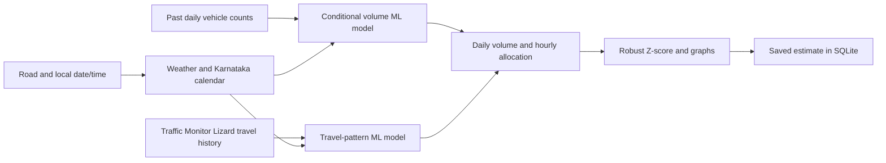

# Urban Traffic Intelligence

A local Python ML application that accepts **road name, date and time**, connects weather and the Karnataka holiday calendar automatically, estimates vehicle traffic, generates graphs, checks for unusual traffic and saves each result.

## Run

The environment, data and trained models are already prepared on this Mac:

```bash
.venv/bin/python -m streamlit run app.py
```

Open the local URL printed by Streamlit, normally `http://localhost:8501`.

For a fresh checkout:

```bash
python3 -m venv .venv
.venv/bin/python -m pip install -r requirements.txt
.venv/bin/python -m traffic_intelligence fetch --volume "/path/to/Banglore_traffic_Dataset.csv"
.venv/bin/python -m traffic_intelligence train
.venv/bin/python -m pytest -q
.venv/bin/python -m streamlit run app.py
```

To retrain only the main traffic estimator:

```bash
.venv/bin/python -m traffic_intelligence train --dataset estimator
```

Python 3.11 or newer is recommended. `requirements-lock.txt` records the exact versions used with Python 3.14.5; use `requirements.txt` for another Python version. Keep the original CSV; its redistribution licence has not been established. Raw data, trained binaries and personal prediction records are ignored by Git.

See [the verification report](reports/verification.md) for the 1 November 2026 clean-install, retraining, live-service and browser checks, including remaining validation limits.

## What the app shows

Choose a road, date and time, then press **Estimate traffic**. No weather selection, calendar entry or manual traffic multiplier is required.

- **Selected hour:** estimated vehicles passing during `[hour, hour + 1h)`. A time such as 12:30 selects the 12:00–13:00 hour; it does not claim vehicles physically occupying a road at that instant.
- **Traffic classification:** **Low** below the displayed lower volume cutoff, **High** above the upper cutoff and **Moderate** between them, including both boundaries. The cutoffs are specific to the road and expressed in estimated vehicles/hour; the graph shows both guides.
- **Daily volume:** the recorded daily value when a completed past road/date is present; otherwise a conditional ML estimate. Missing historical records are estimated and labelled.
- **Conditions:** a prominent weather-condition card (rainy, clear skies, cloudy/overcast, foggy or windy), plus holiday/festival context, day period and road-specific vehicle-volume classification. The weather panel shows available temperature, humidity and precipitation, identifies the day's weather category used for daily-volume estimation and explains the travel model's dry/rainy grouping.
- **Prediction summary:** a short explanation of the estimated hour, weather, festival/calendar context, road reference patterns and anomaly result. Missing weather is disclosed; conditions are context, not proven causes of changes in traffic. The summary is saved with the result and included in its JSON download.
- **Anomalies:** robust Z-scores against earlier real records, with separate volume and travel-pace details. Future alerts describe predicted unusual traffic, not confirmed incidents.
- **Graphs:** a 24-hour traffic profile, overnight/morning/lunch/evening comparisons and recorded daily history.
- **Saved estimates:** persistent local records, downloadable JSON/CSV and comparison with measured daily counts when those later become available.

The **Research explorer** retains data audits, chronological model comparisons, calendar exports, weather comparisons and post-observation anomaly analysis. Those existing advance-forecast experiments remain separate from the main conditional estimator.

## How estimation works



The vehicle-volume model learns from actual supplied daily count labels, road identity, weekday, season, causal lags, rolling statistics, weather category and dated holidays/festivals. Random Forest and histogram gradient boosting are compared on chronological validation dates; the better ML model is used for the main conditional estimate. The historical baseline's score is still reported even if it performs better.

The travel-pattern model learns **minutes per kilometre** from Traffic Monitor Lizard's duration and distance records. Its inputs include route, cyclical hour/weekday/season features, overnight, morning commute, lunch, evening commute, weather, festival context and airport-corridor identity. Airport identity does not force high traffic; morning and lunch effects are learned separately for the available routes. Old Airport Road is not treated as the international-airport expressway.

The count dataset has daily observations; the travel dataset has hourly journey estimates. **Hourly vehicle volume is an explicit approximation:** the daily volume is allocated across 24 hours in proportion to modelled travel pace. Congestion pace and vehicle flow are different quantities; this allocation is a surrogate assumption, not a physical conversion or a model trained on hourly counts. The 24 hourly values sum to the daily volume. Hourly count accuracy remains unmeasured; no synthetic hourly count labels or accuracy figures are manufactured.

The **Low / Moderate / High** label classifies the displayed hourly vehicle estimate. Its lower and upper cutoffs are the one-third and two-thirds quantiles of earlier daily counts for that road, divided by 24 to give an estimated hourly reference. The lower cutoff is rounded down, the upper cutoff up, and classification uses the same rounded vehicle count shown in the dashboard. Both boundaries belong to Moderate. References use the preceding 28 calendar days when at least eight records exist; otherwise they use up to 90 days ending at the latest available earlier count. Fewer than eight valid days produce **Unavailable**. These are reference bands derived from daily counts, rather than measured hourly thresholds or road capacities. The anomaly Z-score remains a separate calculation. Saved results made before this rule retain their original label and are marked as using the earlier travel-time classification.

`traffic_intelligence/context.py` records road/corridor references. Ballari Road and Hebbal Flyover use an Airport Expy proxy; Hosur Road and Sarjapur Road use their named corridors. Selected nearby roads use a labelled corridor proxy; others use the median citywide temporal pattern. These references do not assert that a TML route measures vehicle flow at the selected intersection.

For completed past dates the app first uses the available recorded daily count. Available reference-route journey estimates supply retrospective travel context. If a historical record is absent, the result is labelled a historical estimate; predictions made with a later-trained model are not represented as historical forecasting backtests.

Future queries use only source observations completed by the current time. Source CSVs, rather than saved predictions, supply all historical features and anomaly references. Stale daily count inputs are disclosed alongside results.

## Weather and calendar

[Open-Meteo](https://open-meteo.com/en/docs) supplies city-centre hourly weather automatically on submission, cached for one hour. Forecast weather, recent model history and historical reanalysis are labelled separately. Requests outside the forecast horizon still receive an estimate using calendar/seasonal features and historical weather-category averaging. Network failures use the same disclosed fallback. No API key is needed.

The [Python holidays](https://holidays.readthedocs.io/) India/Karnataka calendar supplies public holidays, festival identity, days before/after festivals and a ±3-day festival window. The calendar also retains the annual 1 November Kannada Rajyotsava state observance, including Sundays, using the [Karnataka DTE reference](https://dtek.karnataka.gov.in/storage/pdf-files/C-20%20syllabus/Balake%20Kannada-2.pdf). An observance flag does not assert an additional statutory office closure. No fixed festival uplift is applied. Calendar dates can be exported as ICS through Research explorer; no personal calendar account is required. Some lunar dates and local observances may require confirmation.

Add announced local events to `data/events.csv`, then retrain:

```csv
date,name,entity,source,known_from
```

Use the exact road/route name or `*` for all. The source and announcement date are required. An event must be known by its forecast origin to become a feature.

## Saved predictions and later checks

Submitted estimates are stored in `data/predictions.sqlite3`. Each append-only record includes the requested road/time, hourly and daily estimates, any recorded daily count, 24-hour profile, weather source/retrieval metadata, calendar flags, model version, anomaly scores and generation time.

Saved estimates are **not** reclassified as measurements and are never read as model training labels. Refreshing the source datasets and retraining can make actual daily counts available later. Saved estimates then show daily absolute error only for requests made before the target time, with a completed measured daily count. Historical lookups are not counted as successful forecasts. There is no claimed hourly error metric without hourly observations.

The dashboard reads the latest 1,000 saved requests. The database retains earlier records as well. Estimates are stored locally; there is no background traffic-feed subscription or automatic scraping of Google Maps.

For a server that will be shared, enable visitor mode:

```bash
TRAFFIC_PUBLIC_MODE=1 .venv/bin/python -m streamlit run app.py
```

Visitor mode limits saved-result lists, exports and result opening to requests made in the current browser session, and hides Research explorer. A new session starts with an empty history; the laptop still retains the records locally. The normal local command shows the owner's full saved history. This setting does not create a public URL; the laptop-sharing launcher is still pending.

## Evaluation and anomaly method

All rows for a civil date stay together: earliest 70% train, next 7.5% model selection, next 7.5% calibration and final 15% test. Model weights are fitted on the training partition; test rows do not choose the model.

Main-estimator scores measure **conditional estimation given recorded weather**. They are not a backtest using archived provider weather forecasts. Reports include MAE, RMSE, R², baseline scores, weather ablation for daily volume and a time/corridor-feature ablation for travel pace. The hourly allocation has no measured count accuracy. Model input contrasts are associations, not causal weather/festival effects.

Main-estimator anomaly references use earlier real observations. The volume reference uses the preceding 28 calendar days when enough values exist, otherwise a disclosed historical reference of up to 90 days ending at the latest available count. Travel-pace references match the reference route, hour and weekday/weekend class. The robust score is `(value - median) / (1.4826 * MAD)`, equivalent to approximately `0.6745 * (value - median) / MAD`; `|Z| > 3` flags a deviation. IQR and a numerical floor handle zero MAD. An insufficient earlier reference produces no score.

The Research explorer also compares Isolation Forest and forecast-residual alerts on held-out observations. Synthetic +50% spikes and -40% drops test the detectors; those scores do not establish real incident detection accuracy.

## Data and attribution

| Source | Labels | Snapshot |
| --- | --- | --- |
| User-supplied Bangalore City Traffic Dataset | Daily vehicle volume | 8,936 rows, 16 roads; 2022-01-01 to 2024-08-09. Collection provenance unverified. |
| [Traffic Monitor Lizard](https://github.com/thecont1/traffic-monitor-lizard) | Google Maps estimated journey duration and associated weather | 114,822 raw readings, 13 routes; 2025-09-25 to 2026-10-31. |

The archives have **no overlapping observation dates**. They supply separate supervised models connected through the disclosed allocation assumption, not a joined road/time dataset. Same-period count-derived environmental impact, congestion and speed are excluded as volume predictors.

Traffic Monitor Lizard attribution: **Mahesh Shantaram / thecont1, CC BY 4.0**. Data are aggregated and transformed locally. No upstream application code is incorporated. Pinned commit: `fd4b32fb4c7507437fb7f5711d64b986e78bb2bb`. URLs, source hashes and acquisition time are retained in `data/raw/sources.json`.

To refresh with another verified commit:

```bash
.venv/bin/python -m traffic_intelligence fetch --revision YOUR_40_CHARACTER_COMMIT_SHA
.venv/bin/python -m traffic_intelligence train
```

The supplied report's baseline/ML and robust-Z-score approach guides the work. The Chew & Asli anomaly survey motivates combined statistical/ML detection. Other supplied surveys provide research context; this project does not reproduce GDAG-SCTT or transfer published accuracy claims.

## Code map

| File | Purpose |
| --- | --- |
| `app.py` | Road/date/time form, automatic connections, graphs and saved-result views |
| `context.py` | Day periods, airport/corridor features and explicit road references |
| `estimation_training.py` | Main conditional ML models and chronological evaluation |
| `estimator.py` | Past lookup, future estimate, hourly allocation and anomaly assessment |
| `explanations.py` | Brief prediction summaries grounded in the stored conditions and anomaly result |
| `storage.py` | Persistent prediction records and reconciliation with later measurements |
| `weather.py`, `calendar.py` | Weather services, Karnataka holidays, local events and ICS |
| `data.py`, `download.py` | Schema audits, completed-hour aggregation and pinned source downloads |
| `features.py`, `models.py`, `training.py` | Historical features, ML pipelines and advance-forecast experiments |
| `anomalies.py`, `research_ui.py` | Detector comparisons and research dashboard |
| `tests/` | Temporal integrity, prediction persistence, weather failure and UI integration |

Source files in the table are inside `traffic_intelligence/` except `app.py` and `tests/`. Machine-readable estimator scores are in `artifacts/estimator/report.json`; the readable report is `reports/results.md`.
